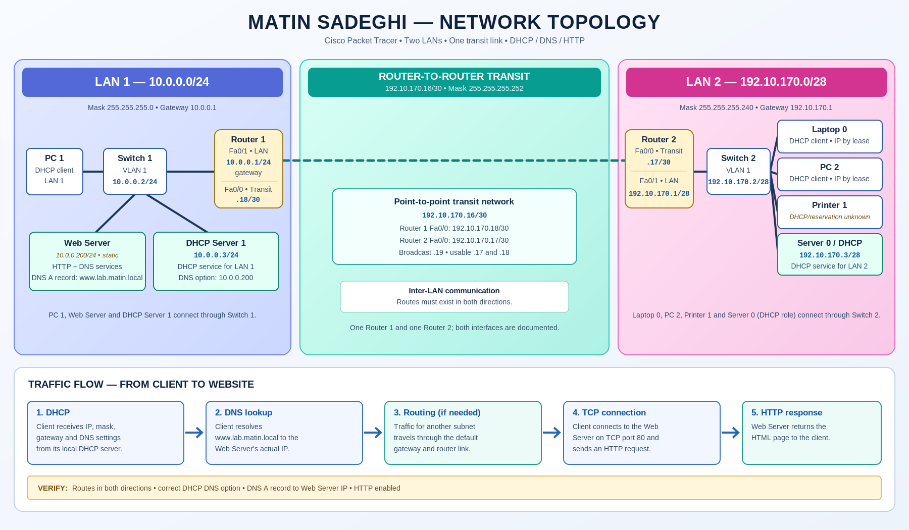

# Matin Sadeghi — Cisco Packet Tracer Network Lab

A beginner networking project documenting a two-LAN topology built in Cisco Packet Tracer. The project combines IPv4 subnetting, DHCP, DNS, HTTP hosting, switching, router-to-router connectivity and troubleshooting in one lab.

> **DNS repair in the bundled lab:** the Web Server is assigned the static address `10.0.0.200/24`, DNS record `www.lab.matin.local` points to `10.0.0.200`, and both DHCP pools advertise `10.0.0.200` as DNS. DHCP Server 2 now starts its pool at `192.10.170.4` to avoid offering the network address.

## Project at a glance

- **LAN 1:** `10.0.0.0/24`
- **Router transit:** `192.10.170.16/30`
- **LAN 2:** `192.10.170.0/28`
- **Website hostname:** [http://www.lab.matin.local](http://www.lab.matin.local) — intended for the Packet Tracer simulation; it is not necessarily publicly resolvable on the internet.
- **Tools:** Cisco Packet Tracer, HTML, CSS, IPv4, DHCP, DNS, HTTP, static routing (if used).

## Topology



Editable source: [network-topology.svg](assets/network-topology.svg).

The complete device inventory includes:

### LAN 1 — `10.0.0.0/24`
- Router 1 — `Fa0/1`: `10.0.0.1/24`.
- Switch 1 — VLAN 1: `10.0.0.2/24`.
- DHCP Server 1 — `10.0.0.3/24`; DHCP pool starts at `10.0.0.4` and provides DNS `10.0.0.200`.
- PC 1 — DHCP client.
- Web Server — `10.0.0.200/24`; hosts HTTP and DNS.

### Router transit — `192.10.170.16/30`
- Router 1 — `Fa0/0`: `192.10.170.18/30`.
- Router 2 — `Fa0/0`: `192.10.170.17/30`.

### LAN 2 — `192.10.170.0/28`
- Router 2 — `Fa0/1`: `192.10.170.1/28`.
- Switch 2 — VLAN 1: `192.10.170.2/28`.
- Laptop 0 — DHCP client.
- PC 2 — DHCP client.
- Printer 1 — DHCP client.
- Server 0 (the DHCP Server 2 role) — `192.10.170.3/28`; pool starts at `192.10.170.4` and provides DNS `10.0.0.200`.

## Repository structure

```text
enterprise-network-infrastructure/
├── index.html                       # Website dashboard (HTML + CSS in one file)
├── README.md                        # Project overview and quick start
├── LICENSE                          # MIT license
├── CHANGELOG.md                     # Project changes
├── CONTRIBUTING.md                  # Contribution and editing guidelines
├── .gitignore                       # Common temporary/local files
├── assets/
│   ├── network-topology.svg          # Accurate editable topology diagram
│   ├── network-topology-preview.png  # PNG preview of the SVG diagram
│   └── packet-tracer-topology-reference.png  # Screenshot of the supplied topology
├── docs/
│   ├── ADDRESSING-PLAN.md            # IPs, masks and subnet calculations
│   ├── GITHUB-PUBLISHING.md          # Git and GitHub Pages instructions
│   ├── COMMIT-PLAN.md                 # Initial and follow-up commit plan
│   ├── PROJECT-STRUCTURE.md          # Folder/file guide
│   ├── ROUTING.md                    # Transit link and static route notes
│   ├── SERVICES.md                   # DHCP, DNS and HTTP setup
│   ├── TOPOLOGY.md                   # Full device inventory and links
│   ├── TROUBLESHOOTING.md            # Verification checklist
│   └── DNS-FIX-REPORT.md              # DNS/DHCP root cause and repair record
└── packet-tracer/
    ├── matin-network-lab.pkt        # Repaired Packet Tracer topology
    └── README.md                     # Notes for opening and verifying the lab
```

## View the website locally

1. Download or clone this repository.
2. Open `index.html` in a web browser.
3. Review `docs/` for addressing and configuration details.

The HTML and CSS are self-contained; no build tools or external libraries are required.

## Test the lab in Packet Tracer

1. Open `packet-tracer/matin-network-lab.pkt` in Cisco Packet Tracer.
2. Confirm the router interface addresses, subnet masks and interface states.
3. Confirm both DHCP servers are enabled and each pool provides the correct gateway and DNS server.
4. Confirm the Web Server is static at `10.0.0.200/24`, with gateway `10.0.0.1`.
5. Confirm the DNS A record for `www.lab.matin.local` points to `10.0.0.200`, and both DHCP pools hand out DNS `10.0.0.200`.
6. Confirm HTTP and DNS are enabled on the Web Server.
7. Verify routes between both LANs.
8. Test by IP address first, then test `http://www.lab.matin.local` from clients on both LANs.

See [Troubleshooting](docs/TROUBLESHOOTING.md) for a more detailed checklist. The uploaded `.pkt` file is bundled in `packet-tracer/`; reopen it in Packet Tracer before publishing to confirm it loads and contains the expected topology.

## Important configuration distinction

The Web Server and DHCP Server 1 are separate devices. In the repaired project, the Web Server has a static IP of `10.0.0.200/24`, while DHCP Server 1 is `10.0.0.3/24`. The DNS A record and DNS options in both DHCP pools now point to `10.0.0.200`.

## Publish with GitHub Pages

Follow [GitHub publishing instructions](docs/GITHUB-PUBLISHING.md). Enable Pages for the repository using the `main` branch and `/ (root)` as the publishing source. The site's `index.html` is at the repository root.

## License

Released under the MIT License; see [LICENSE](LICENSE).
